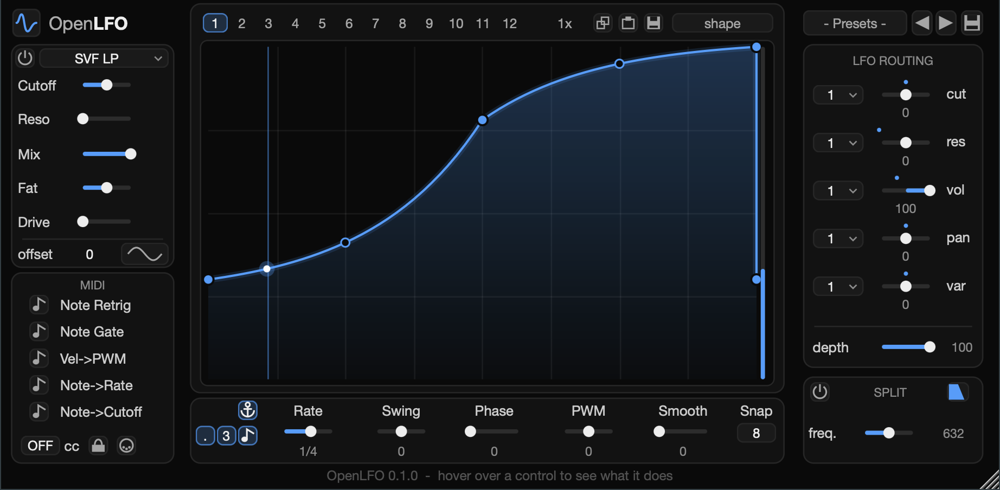

# OpenLFO


A JUCE 8 audio plugin (VST3, AU, Standalone; macOS): twelve drawable LFO graphs routed to filter cutoff, resonance, volume, pan and a per-filter "var" control, with a multi-mode filter, band split, MIDI control and MIDI CC output.



**Status:** 0.1.0, an early release. The AU and VST3 pass `auval` and `pluginval` (strictness 10), but host tempo sync, automation and the MIDI drag gesture have not yet been tried in a DAW. There are no prebuilt binaries; build it from source as below.

## Build

Needs macOS 11 or later, the Xcode command line tools, CMake 3.24+ and Ninja (`brew install cmake ninja`).

```bash
git clone --recurse-submodules https://github.com/CryoSnake22/OpenLFO.git
cd OpenLFO                    # or, in an existing clone:
git submodule update --init   # JUCE 8.0.12
make build                    # cmake -B build -G Ninja && cmake --build build
make run                      # build + open the Standalone app
make build CONFIG=Release
```

Artefacts land in `build/OpenLFO_artefacts/<Config>/{VST3,AU,Standalone}/OpenLFO.*`. `COPY_PLUGIN_AFTER_BUILD` is on, so the VST3 and AU are also installed to the user plugin folders.

## Using it

- **Graph**: double-click to add a point, double-click or right-click a point to remove it, drag to move (Alt snaps to the grid), drag a hollow handle to bend a segment (Alt bends them all), Shift-click to add a flat step one grid cell wide.
- **Display button** (beside *offset*): cycles graph → oscilloscope → filter frequency response.
- **MIDI notes 0–59** choose the source graph for cut / res / vol / pan / var, twelve notes each. Notes also drive Note Retrig, Note Gate, Vel→PWM, Note→Rate and Note→Cutoff.
- **CC out** sends the final cutoff value; the round MIDI button drags the current graph into the host as a CC clip.

## User files

Everything lives in `~/Library/Application Support/JezzterInc/OpenLFO/`:

- `Presets/` — `.lfopreset` files. Subfolders become submenus. `Presets/Factory/` is written the first time the editor opens, if it does not exist.
- `Shapes/` — `.lfoshape` files (one graph each), listed in the shape menu.
- `OpenLFOConfig.txt` — global settings with no control in the interface, read once when the plugin loads.

## Licence

OpenLFO is released under the [GNU Affero General Public License v3.0](LICENSE), the same open-source licence as the JUCE framework it is built on.
